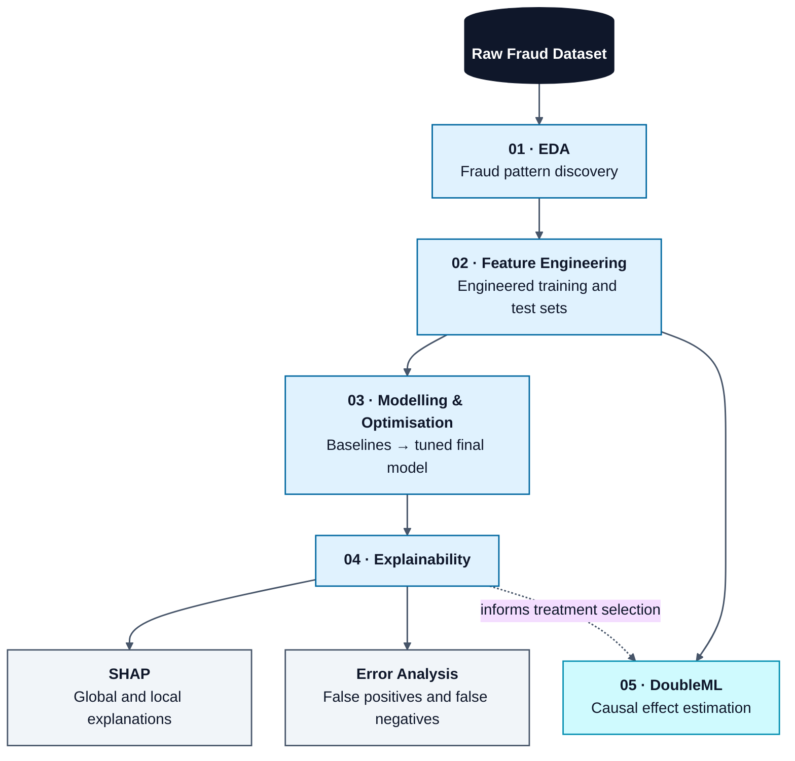
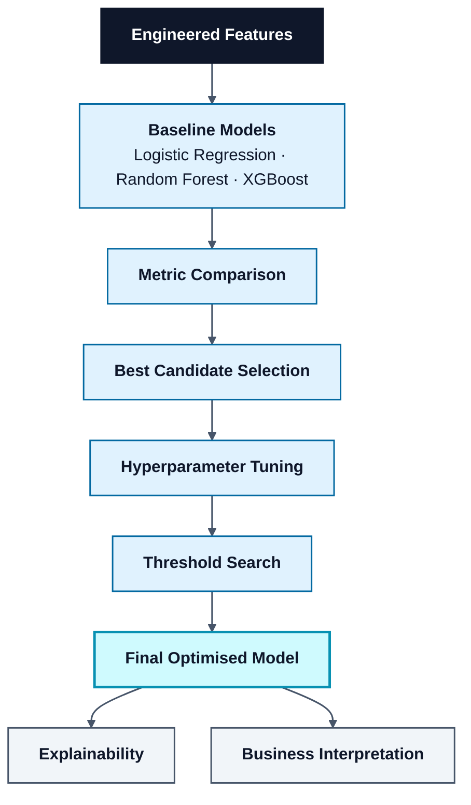
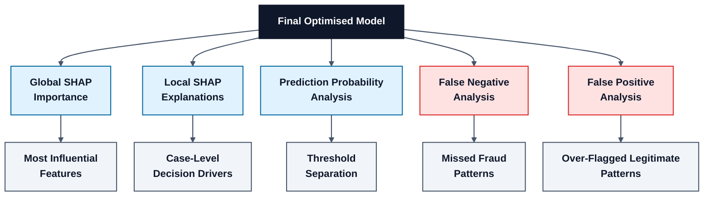
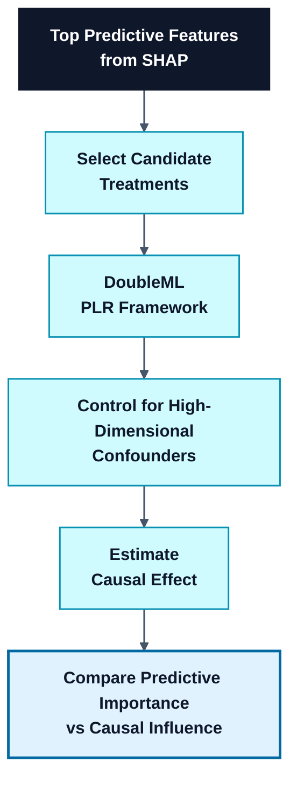

<div align="center">

# Credit Card Fraud Detection

### From raw transactions to explainable, causally-informed fraud intelligence

A full end-to-end fraud analytics and machine learning project built entirely in notebooks, covering exploratory data analysis, feature engineering, predictive modelling, explainability, and causal inference.

<br/>

<p align="center">
  
  
  
  
</p>

<p align="center">
  
  
  
  
  
  
</p>

<p align="center">
  
  
  
</p>

[**Results**](#key-results) · [**Pipeline**](#notebook-pipeline) · [**Architecture**](#architecture) · [**Methods**](#core-methods) · [**Explainability**](#explainability-logic) · [**Causal Inference**](#causal-inference-logic) · [**Roadmap**](#future-improvements)

</div>

---

## Table of Contents

- [Overview](#overview)
- [Key Results](#key-results)
- [Project Objectives](#project-objectives)
- [Notebook Pipeline](#notebook-pipeline)
- [Repository Structure](#repository-structure)
- [Architecture](#architecture)
- [Core Methods](#core-methods)
- [Key Project Highlights](#key-project-highlights)
- [Recommended Reading Order](#recommended-reading-order)
- [Analytical Questions Answered](#analytical-questions-answered)
- [Technical Themes Demonstrated](#technical-themes-demonstrated)
- [Modelling Decision Pipeline](#modelling-decision-pipeline)
- [Explainability Logic](#explainability-logic)
- [Causal Inference Logic](#causal-inference-logic)
- [Project Deliverables](#project-deliverables)
- [Future Improvements](#future-improvements)
- [Author](#author)
- [License](#license)

---

## Overview

This repository presents a notebook-based fraud detection pipeline built on a large credit card transaction dataset. It goes beyond basic classification to deliver a complete analytics workflow that answers five questions:

| # | Question |
|:---:|---|
| **1** | What patterns define fraudulent behaviour in the raw data? |
| **2** | Which engineered features improve fraud detection most? |
| **3** | Which predictive models perform best on an imbalanced classification problem? |
| **4** | Why does the final model make the decisions it makes? |
| **5** | Which important variables are merely predictive, and which show evidence of causal influence? |

The project is organised as a sequence of notebooks so that each stage is transparent, reproducible, and easy to review.

---

## Key Results

<div align="center">

| Metric | Result |
|---|:---:|
| **ROC-AUC** | **~0.98** |
| **Precision (fraud)** | High |
| **Recall (fraud detection)** | Optimised to reduce false negatives |
| **False negatives** (missed fraud) | **343** |
| **False positives** (legitimate transactions flagged) | **294** |

</div>

The final model strikes a strong balance between detecting fraudulent transactions and minimising disruption to legitimate customers. The decision threshold is tuned for the precision-recall trade-off rather than left at the default cutoff.

---

## Project Objectives

- Perform high-quality exploratory data analysis on fraud transactions
- Build strong, fraud-relevant engineered features
- Train and compare multiple machine learning models
- Optimise the best model for precision-recall trade-offs
- Explain predictions globally and locally using SHAP
- Extend the project beyond prediction into causal analysis with Double Machine Learning

---

## Notebook Pipeline

| Stage | Notebook | Focus |
|:---:|---|---|
| **1** | [`01_eda.ipynb`](01_eda.ipynb) | Transaction behaviour, class imbalance, temporal risk patterns, geographic fraud concentration, category-level behaviour, demographic trends, and core fraud signals |
| **2** | [`02_feature_engineering.ipynb`](02_feature_engineering.ipynb) | Turns raw transactions into a richer modelling dataset: behavioural, temporal, customer-level, merchant-level, location-level and category-based risk features |
| **3** | [`03_modeling_and_optimization.ipynb`](03_modeling_and_optimization.ipynb) | Baseline models trained, tuned, evaluated, compared and optimised for the fraud detection objective |
| **4** | [`04_explainability.ipynb`](04_explainability.ipynb) | SHAP and error analysis: global feature importance, local decision patterns, false positives, false negatives, and probability behaviour around the final threshold |
| **5** | [`05_doubleML.ipynb`](05_doubleML.ipynb) | Double Machine Learning to estimate the causal impact of selected high-value fraud-related features |

---

## Repository Structure

```text
Credit-Card-Fraud-Detection/
│
├── 01_eda.ipynb
├── 02_feature_engineering.ipynb
├── 03_modeling_and_optimization.ipynb
├── 04_explainability.ipynb
├── 05_doubleML.ipynb
├── requirements.txt
└── README.md
```

---

## Architecture

### End-to-end workflow



### System layers

```mermaid
%%{init: {
  "theme": "base",
  "themeVariables": {
    "fontFamily": "Inter, Segoe UI, Helvetica, Arial, sans-serif",
    "primaryTextColor": "#0f172a",
    "lineColor": "#475569"
  },
  "flowchart": { "curve": "basis", "nodeSpacing": 30, "rankSpacing": 50, "htmlLabels": true }
}}%%
flowchart LR
    RAW[("<b>Raw Transaction<br/>Data</b>")] --> EDA["<b>EDA<br/>Layer</b>"]
    EDA --> FE["<b>Feature Engineering<br/>Layer</b>"]
    FE --> MOD["<b>Modelling<br/>Layer</b>"]
    MOD --> OPT["<b>Optimisation<br/>Layer</b>"]
    OPT --> XAI["<b>Explainability<br/>Layer</b>"]
    OPT --> CAUSAL["<b>Causal Inference<br/>Layer</b>"]

    subgraph FEAT["&nbsp;ENGINEERED FEATURE FAMILIES&nbsp;"]
        direction TB
        C1["Temporal"]
        C2["Behavioural"]
        C3["Customer aggregates"]
        C4["Merchant risk"]
        C5["Category risk"]
        C6["Geographic risk"]
    end
    FE -.-> FEAT

    classDef data  fill:#0f172a,stroke:#0f172a,color:#ffffff;
    classDef layer fill:#e0f2fe,stroke:#0369a1,stroke-width:1.5px,color:#0f172a;
    classDef xai   fill:#cffafe,stroke:#0891b2,stroke-width:1.5px,color:#0f172a;
    classDef feat  fill:#f8fafc,stroke:#94a3b8,color:#0f172a;
    class RAW data;
    class EDA,FE,MOD,OPT layer;
    class XAI,CAUSAL xai;
    class C1,C2,C3,C4,C5,C6 feat;
    style FEAT fill:#ffffff,stroke:#0891b2,stroke-width:1.5px,stroke-dasharray: 6 4
    linkStyle default stroke:#475569,stroke-width:1.6px
```



---

## Core Methods

| Area | Techniques |
|---|---|
| **1. Exploratory Data Analysis** | Class balance analysis · distribution analysis · log-transformed amount analysis · temporal fraud profiling · state and city concentration · category and gender comparisons · geographic plotting · correlation analysis |
| **2. Feature Engineering** | Transaction amount transformations · high-value transaction flags · customer historical aggregates · same-day transaction behaviour · merchant risk statistics · category-level fraud context · geographic risk summaries · night transaction behaviour · age band and population band indicators |
| **3. Predictive Modelling** | Logistic Regression · Random Forest · XGBoost |
| **4. Model Optimisation** | Hyperparameter tuning · threshold optimisation · precision-recall trade-off analysis · final model comparison |
| **5. Explainability** | Global feature importance · SHAP summary plots · SHAP dependence analysis · high-risk and low-risk local case analysis · false positive and false negative profiling |
| **6. Causal Analysis** | Double Machine Learning · Partially Linear Regression (PLR) framework · multi-feature causal effect estimation |

---

## Key Project Highlights

- Handles an **extreme class imbalance** problem in a principled way
- Uses **fraud-sensitive metrics**: Precision, Recall, F1-score, ROC-AUC and PR-AUC
- Moves from **descriptive analysis** to **predictive modelling** to **causal interpretation**
- Demonstrates both **model performance** and **model transparency**
- Includes **threshold tuning** instead of relying on default classification cutoffs
- Distinguishes between **predictive importance** and **causal relevance**

---

## Recommended Reading Order

For the clearest understanding of the project, review the notebooks in this order:

1. [`01_eda.ipynb`](01_eda.ipynb)
2. [`02_feature_engineering.ipynb`](02_feature_engineering.ipynb)
3. [`03_modeling_and_optimization.ipynb`](03_modeling_and_optimization.ipynb)
4. [`04_explainability.ipynb`](04_explainability.ipynb)
5. [`05_doubleML.ipynb`](05_doubleML.ipynb)

---

## Analytical Questions Answered

- Which transaction patterns are most associated with fraud?
- How does fraud risk vary across hours, days and months?
- Which states, cities and categories are most exposed?
- Which engineered features matter most for model performance?
- Which model offers the strongest precision-recall balance?
- What kinds of transactions become false positives and false negatives?
- Which top predictive drivers also show evidence of causal importance?

---

## Technical Themes Demonstrated

| | |
|---|---|
| Large-scale tabular fraud analytics | Imbalanced binary classification |
| Feature engineering for behavioural risk | Interpretable machine learning |
| Threshold optimisation | Error analysis |
| Causal machine learning | |

---

## Modelling Decision Pipeline



---

## Explainability Logic



---

## Causal Inference Logic



> [!NOTE]
> Causal estimates from Double Machine Learning depend on the framework's identification assumptions, such as having controlled for the relevant confounders. Treat them as evidence of causal influence, not proof.

---

## Project Deliverables

- A structured five-notebook fraud pipeline
- Engineered modelling datasets
- Baseline and optimised classification models
- Explainability analysis of the final model
- Causal effect estimates for selected fraud drivers

---

## Future Improvements

- [ ] Sequence modelling for transaction history
- [ ] Graph-based fraud detection
- [ ] Real-time scoring simulation
- [ ] Calibration diagnostics
- [ ] Drift monitoring across time periods
- [ ] Advanced uplift or treatment-heterogeneity analysis

---

## Author

**Nomusa Shongwe**

*Data Science · Machine Learning · Fraud Analytics · Explainable AI · Causal Inference*

---

## License

This project is released under the MIT License.

<div align="center">

<sub>[Back to top](#credit-card-fraud-detection)</sub>

</div>
